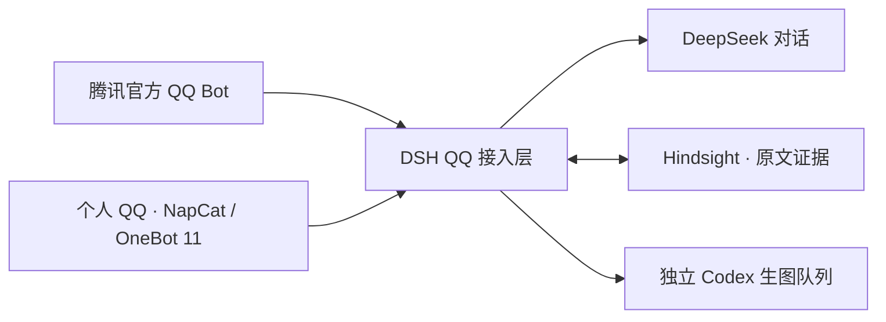

# 柚柚 QQ Agent

**在 QQ 中聊天、管理群参与，并保留可追溯的真实记忆。**

[](docs/deployment/windows.md)
[](app/versions.json)
[](docs/reference/V2_3_HINDSIGHT_MEMORY.md)

[开始部署](docs/deployment/README.md) · [使用指南](docs/usage/README.md) · [开发文档](docs/development/README.md) · [更新记录](CHANGELOG.md)

柚柚是基于 **DeepSeek Harness（DSH）** 的 QQ AI 助手，使用 **DeepSeek** 进行文字对话，使用 **Hindsight** 管理长期记忆。项目同时支持腾讯官方 QQ Bot，以及个人 QQ + NapCat / OneBot 11 两种接入方式。

当前应用版本为 **V3.5.0**，业务插件为 **0.22.6**。可运行工程位于 [`app/`](app/README.md)，安装、配置和启动命令均从该目录执行。

## 可以做什么

| 能力 | 内容 |
|---|---|
| 聊天与记忆 | 真实聊天记忆、近期原文接续、带来源的历史查询与遗忘 |
| 群聊参与 | 按群授权、接话档位、自定义节奏、真实成员 @、多个群控制者 |
| 图片能力 | 图片识别，以及用户明确请求的 Codex 内置生图 |
| 日常工具 | 时区、时间计算、私聊课表及可配置的主动消息 |
| 本机管理 | Windows 控制台、服务启停、生图任务、日志、备份与导出 |

Hindsight 和本地 embedding 在需要时加载，相关工作与队列空闲 **5 分钟**后释放。群聊、私聊和不同账号使用独立的身份分区。

## 选择 QQ 接入方式

| 方案 | 收发方式 | 准备条件 | 部署入口 |
|---|---|---|---|
| 腾讯官方 QQ Bot | Tencent QQ Bot SDK | Bot 应用、AppID / AppSecret、平台私聊与群权限 | [官方 QQBot 指南](docs/deployment/official-qqbot.md) |
| 个人 QQ + NapCat | 本机 OneBot 11 WebSocket | 个人 QQ、QQ 客户端、NapCat，以及当前启动器要求的应用配置 | [NapCat / OneBot 指南](docs/deployment/onebot-napcat.md) |

两种方案共用业务插件和记忆服务，每个运行实例选择一种传输方式。OneBot 的账号、群映射和访问令牌在本机配置；迁移已有记忆时需保留原逻辑身份映射。

## 开始使用

基础环境为 Windows、PowerShell 5.1+、Node.js 24、Python 3.12 x64 和 pnpm 11.25。完整固定版本见 [`app/versions.json`](app/versions.json)。

**1. 获取源码，进入运行目录。**

```powershell
git clone https://github.com/Hitachi-Mako71/shuimu-qqbot-dsh-hymemory.git
Set-Location .\shuimu-qqbot-dsh-hymemory\app
```

**2. 完成[基础安装](docs/deployment/windows.md)，然后选择上方一种 QQ 接入方案配置账号。**

**3. 配置完成后管理服务。**

```powershell
.\start-all.ps1       # 启动
.\robot-control.ps1   # 打开 Windows 控制台
.\stop-all.ps1        # 停止
```

Codex 生图需要本机 Codex 登录和独立的生图绑定，具体见[生图指南](docs/usage/images.md)。QQ 文字对话由 DeepSeek 处理。

## 工作方式



## 文档导航

| 想了解什么 | 文档 |
|---|---|
| 安装与接入 | [部署导航](docs/deployment/README.md) · [Windows 安装](docs/deployment/windows.md) |
| 群聊、记忆和图片 | [群聊管理](docs/usage/groups.md) · [记忆与原文](docs/usage/memory.md) · [生图](docs/usage/images.md) |
| 配置与运行资源 | [配置说明](docs/deployment/configuration.md) · [按需加载](docs/usage/performance.md) |
| 升级与恢复 | [已有部署升级](docs/deployment/upgrading.md) · [备份与恢复](docs/deployment/backup-and-recovery.md) |
| 源码与维护 | [架构](docs/development/architecture.md) · [目录说明](docs/development/repository-layout.md) · [发布流程](docs/development/releasing.md) |
| 技术契约与历史资料 | [技术参考](docs/reference/README.md) · [历史归档](archive/README.md) |

## 仓库结构

```text
app/                      完整可运行工程
  dsh-hymemory-plugin/     QQ 业务插件与 OneBot 适配
  dependency-locks/        固定依赖
  patches/                Tencent QQ 插件补丁
  packages/               当前业务插件包
  examples/               安全配置模板
docs/
  deployment/             安装、两种 QQ 接入、配置、升级与备份
  usage/                  群聊、记忆、生图与控制台
  development/            架构、维护与发布
  reference/              分版本技术契约
archive/                  旧模块、旧包与历史报告
```

凭证、QQ 登录态、OneBot 私有映射、聊天、记忆、附件和日志保存在本机；NapCat / QQ 二进制由部署者自行获取。历史模块不参与当前安装流程，已有运行实例更新前请阅读[升级说明](docs/deployment/upgrading.md)。
