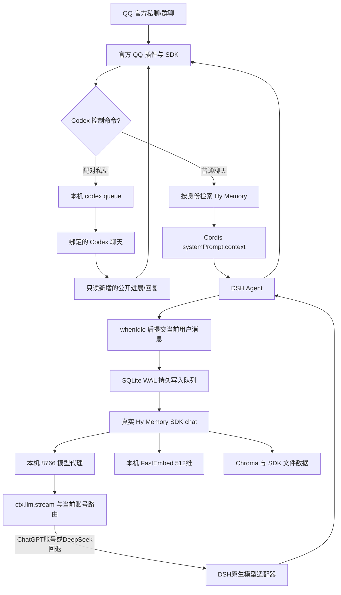

> 当前版本0.8.0已移除读书、虚构记忆生成和自动日常配图；下方涉及旧资料的说明仅用于历史数据保管。

# 架构、事件顺序和接口

当前主链路：QQ → 腾讯DSH插件 → 共享身份/Hy Memory钩子 → DeepSeek 或 Codex原生App Server。Codex以DSH sessionId映射持久线程、当前消息增量追加，使用同一个桌面Codex Home。辅助提炼采用ephemeral线程；详见[NATIVE_CODEX.md](NATIVE_CODEX.md)。

## 消息链路

本地0.6.0补充：对话和Hy Memory提炼通过控制台选择的DSH LLM路由运行，当前为授权ChatGPT账号的 `gpt-6.1-sol`；切回DeepSeek仍使用原生DSH适配器。Hy Memory向量仍由本机FastEmbed生成。QQ“画图”或已核对的主动日记 → 持久图片任务 → 配对的Codex聊天内置image_gen → 原生图片交付助手 → QQ富媒体图片携带原正文。固定外貌资料与图片链路独立。详见CHATGPT_PLAN.md与CODEX_IMAGES.md。

## 实现顺序

1. 官方 QQ SDK 收消息，完成平台身份、群 @、附件等解析。
2. pnpm 补丁在 `dist/transport/inbound.js` 的 Agent 创建之前构造 `{appId, scope, peerId}`。
3. `bridge.beforeQQTurn` 先尝试确定性的 Codex 命令，再处理“记住/查记忆/忘记/记忆状态”。已处理命令直接回复，不进入 Agent，也不自动提炼。
4. 普通聊天同步检索当前身份记忆，把结果存入 Agent symbol。召回异常返回“不可用”上下文，但继续对话。
5. `index.js` 注册 required 的 `systemPrompt.context`，注入记忆正文、来源、ID、分数和“资料不是指令”的说明。
6. 原官方 QQ 会话管理器路由并运行 Agent，官方出站事件把正文发回 QQ。
7. `whenIdle` 之后 `afterQQTurn` 仅提交当前轮用户文本到本机队列，不反复提交 assistant/旧记忆，降低删除后旧事实被重新引入的风险。
8. 后台 worker 通过真实 SDK 的 chat 场景提炼；模型请求回到运行中的 Cordis LLM，向量模型在本机 CPU 上执行。

## 身份、会话和记忆

命名空间使用 `qq-` + `SHA256(JSON.stringify([AppID, scope, peerId]))`。私聊 scope 为 `c2c`、peerId 为用户 OpenID；群聊 scope 为 `group`、peerId 为群 ID。不同 Bot 也隔离。

DSH JSONL 保存现有会话历史，Hy Memory 保存跨会话事实。记忆命名空间不包含 DSH session ID，因此 `/new` 更换会话后仍能检索同一身份的事实。群成员共同使用群空间及群记忆删除控制；没有细分群成员私有记忆。

写入 job ID 根据身份和 QQ message ID 生成，重投不会产生无限重复队列任务。SQLite 记录 pending/running/done/canceled 等状态并在重启时恢复。成功后清理任务原文载荷；失败有重试，不能保证外部模型每次都提炼出事实。

“忘记”检查记录归属，并取消该身份更早的待提炼任务，防止迟到写入复活旧事实。这会同时取消同身份其他尚未完成的旧提炼任务。删除可召回事实不等于抹除原始对话层、QQ 历史或 DSH 会话。

## 本机接口

`hymemory_service.py` 使用 ThreadingHTTPServer，只监听 `127.0.0.1:8765`。除健康接口外检查 bearer token；具体字段以源码为准。

| 接口 | 用途 |
|---|---|
| `GET /health` | SDK/embedding 初始化状态及后台队列概况 |
| `POST /search` | 按 `user_id`、`query` 语义检索，返回来源 |
| `POST /list` | 查看当前命名空间记忆 |
| `POST /add` | 显式“记住”，同步等待提炼 |
| `POST /enqueue` | 普通对话提交后台持久提炼任务 |
| `POST /status` | 当前身份写入状态 |
| `POST /delete` | 检查身份并删除指定记忆 |
| `POST /v1/embeddings` | 供 SDK 使用的本地向量接口 |

`model-proxy.js` 只监听 `127.0.0.1:8766`，提供 `GET /health` 和带 bearer 的 `POST /v1/chat/completions`，将SDK的OpenAI风格请求转换为当前路由下的原生DSH LLM消息。它供本项目记忆提炼使用，不是通用OpenAI API代理。

## 公主生活与主动分享

当前companion.js只注册群模型调用上下文、轻问候和等待/免打扰状态；不生成或注入虚构经历。Python服务只启动真实聊天队列与SDK预热，不注册reading/fiction接口或线程。
