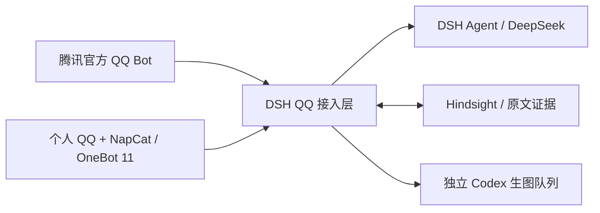

# 系统架构

两种 QQ 方案共享业务中间件、可信身份、群参与和会话流程。官方模式使用 Tencent SDK；OneBot 模式替换实际 transport 并校验登录账号及允许的群。

Node 插件位于 `app/dsh-hymemory-plugin/`。Python 记忆接口、Hindsight 适配和生命周期服务位于 `app/`；模块与启动脚本保留同一运行根目录。Node 与 Python 通过带身份校验的本机接口及证据 SQLite 协作。

原文先归档，提炼引用真实来源；已被平台接受的助手内容才进入相应发送记录。私聊、群聊、删除版本及派生来源在整个链路上检查。契约见[身份边界](../reference/V1_1_IDENTITY_BOUNDARIES.md)、[原文证据](../reference/V1_2_EVIDENCE_JOURNAL.md)与[隐私生命周期](../reference/V1_3_PRIVACY_LIFECYCLE.md)。

Hindsight 和 embedding 按需启动并在空闲后释放。文字对话使用 DeepSeek，Codex 仅处理用户明确请求的独立生图任务。
